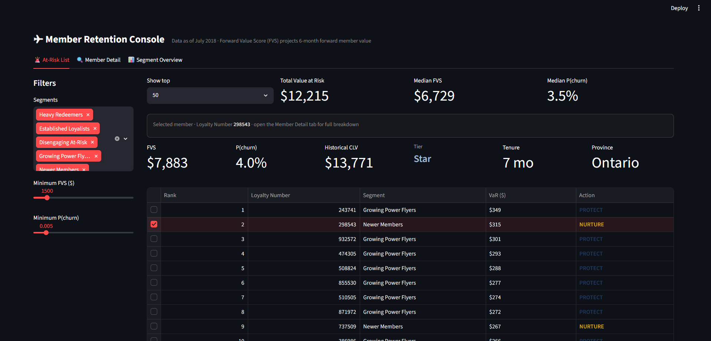

# Smart Retention using Behavioral Intelligence in Airline Loyalty Programs 

End-to-end data science engagement on a Canadian airline's loyalty program, predicting which members are likely to disengage, segmenting customers by forward economic value, and delivering a working prototype that converts model output into a marketing playbook a non-technical manager can act on without training.



---

## Problem Context

Airlines use loyalty programs to drive repeat business, but most still measure value through historical Customer Lifetime Value (CLV) — a backward-looking metric that does not flag silently disengaging members until after they have effectively left.

Three questions:

1. Which members are likely to stop engaging in the coming months, regardless of formal cancellation?
2. Which members represent the greatest economic value to retain going forward?
3. What specific action should the marketing team take for each at-risk member, and when?

## Approach

The engagement followed five phases of structured work:

- **Phase 1 - Problem Framing & Strategic Planning.** Behavioral churn definition, literature review across 14 citations, methodology commitments.
- **Phase 2 - Data Acquisition, Preprocessing & EDA.** Audit, cleaning of 12 documented anomalies (including the discovery that ~50% of formal cancellations were system artifacts), churn labeling.
- **Phase 3 - Modeling.** Lean feature engineering, L2 logistic regression baseline, LightGBM primary model with SHAP explainability, K-means segmentation, and a Forward Value Score (FVS) metric introduced to challenge the existing CLV.
- **Phase 4 - Visualization & Prototype.** Streamlit application implementing the at-risk list, member detail drill-down, and segment overview, with FVS surfaced throughout.
- **Phase 5 - Evaluation, Optimization & Recommendations.** Multi-metric evaluation, calibration via Platt scaling, comparison of three class-imbalance strategies, and three CFO/CMO-grade business recommendations.

## Key Findings

**Loyalty tier does not track flying behavior.** Star, Nova, and Aurora-tier members fly at nearly identical rates (~18 flights/year median across all three). Aurora-tier members have the highest churn rate of any tier (0.88% vs 0.62% for Star). The existing tier system cannot detect silent attrition of high-value members.

**~50% of formal cancellations are mechanical, not member-initiated.** Exactly 1,048 of 2,067 cancelled members cancelled at precisely 8 months tenure with `cancellation_month = enrollment_month + 8 (mod 12)`, must be an automated rule rather than user behavior. This validated the engagement's behavioral churn definition.

**Historical CLV is essentially uniform across behavioral segments while forward value varies 4.5x.** Across the five segments identified by K-means, average CLV ranges $7,692–$8,569 (12% spread). The Forward Value Score we introduce ranges $926–$4,222 (4.5x spread). About 12% of the cohort is materially mis-classified by CLV alone — "ghost-value veterans" (high CLV, low FVS) and "undervalued risers" (low CLV, high FVS).

## Three Business Recommendations (CFO + CMO defensible)

1. **Adopt Forward Value Score alongside CLV** as the primary value metric for retention decisions. Same data inputs, more accurate forward signal.
2. **Operationalize the five-segment retention structure** with urgent CSR-led intervention (within 5 days) for the Disengaging At-Risk segment and explicit deprioritization for Heavy Redeemers.
3. **Introduce a behavior-linked tier dimension** alongside the existing Star/Nova/Aurora system to address the structural finding that current tiers do not track behavior.

## Repository Structure

```
AirlinePS/
├── README.md
├── requirements.txt
├── .gitignore
├── app.py                          # Streamlit prototype
├── data/
│   ├── raw/                        # Source CSVs 
│   └── processed/                  # Engineered CSVs
├── notebooks/
│   ├── phase2_airline_loyalty_eda.ipynb
│   ├── phase3_modeling_v2.ipynb
│   ├── phase3_forward_value_score.ipynb
│   └── phase5_evaluation_optimization.ipynb
├── figures/                        # EDA, modeling, plots
├── screenshots/                    # Prototype screenshots
└── results/                        # Metric files, per-segment outputs
```

## Running the Prototype

```bash
# Install dependencies
python -m pip install -r requirements.txt

# Launch the Streamlit console
python -m streamlit run app.py
```

The app opens at `http://localhost:8501` with three views accessible via the top navbar.

## Reproducing the Analysis

Notebooks should be run in order:

1. `notebooks/phase2_airline_loyalty_eda.ipynb` - loads raw data, applies cleaning decisions, produces the panel and labeled snapshots.
2. `notebooks/phase3_modeling_v2.ipynb` - feature engineering, LightGBM + LR training, Optuna tuning, SHAP, segmentation.
3. `notebooks/phase3_forward_value_score.ipynb` - Forward Value Score computation and gap analysis.
4. `notebooks/phase5_evaluation_optimization.ipynb` - calibration experiments and class-imbalance comparison.

Processed artifacts are included in `data/processed/` so the prototype runs without re-executing notebooks.

## Final Model Performance

| Metric | Value |
|---|---|
| Train set | 10,925 members at January 2018 (83 churners, 0.76% positive rate) |
| Test set | 11,834 members at July 2018 (71 churners, 0.60% positive rate) |
| PR-AUC | 0.0318 (~5x random baseline of 0.006) |
| ROC-AUC | 0.5889 |
| Brier score (calibrated) | 0.00596 (28% improvement post Platt-scaling) |
| Lift @ top 10% | 2.11x |

Modest absolute discrimination reflects the structural data constraint of 154 total churners. The segmentation framework carries most of the operational signal; the model serves as a within-segment ranking refinement.

## Tech Stack

`Python` `pandas` `numpy` `scikit-learn` `LightGBM` `Optuna` `SHAP` `imbalanced-learn` `matplotlib` `seaborn` `Streamlit` `Altair`
